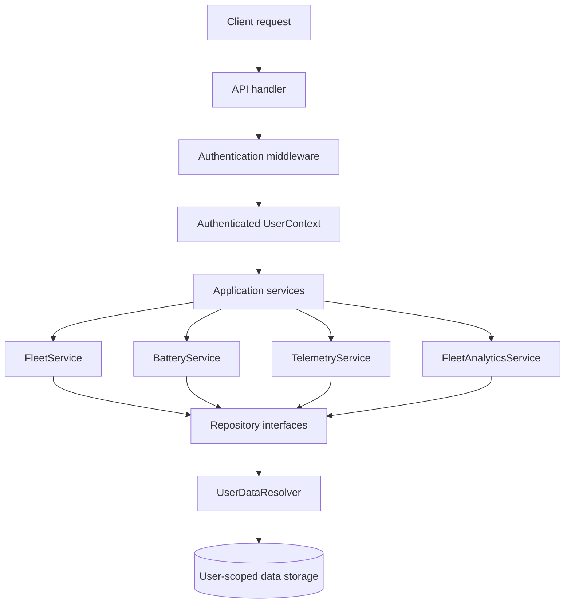
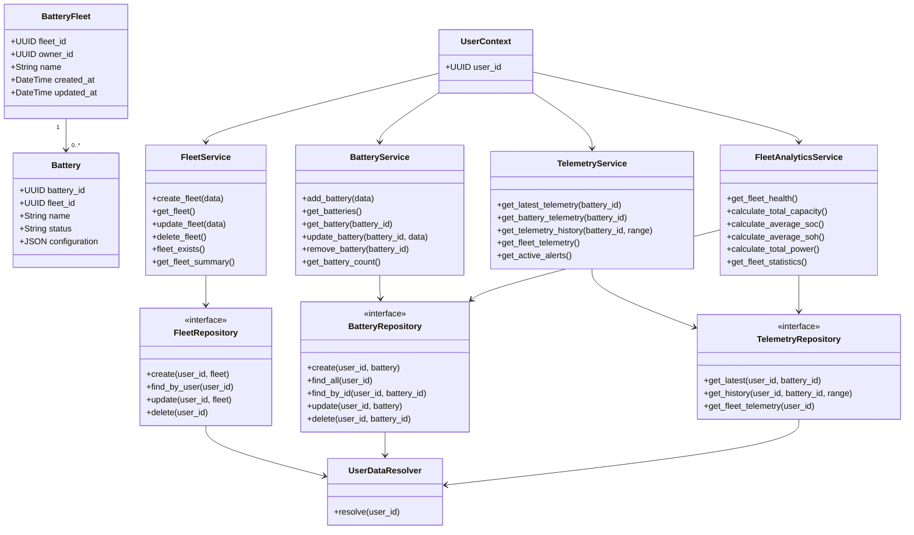
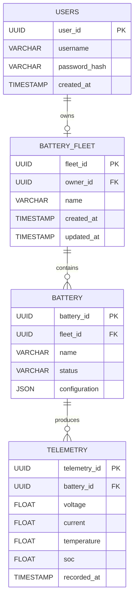
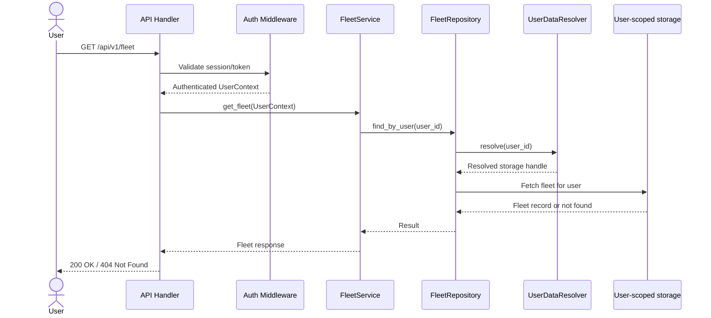
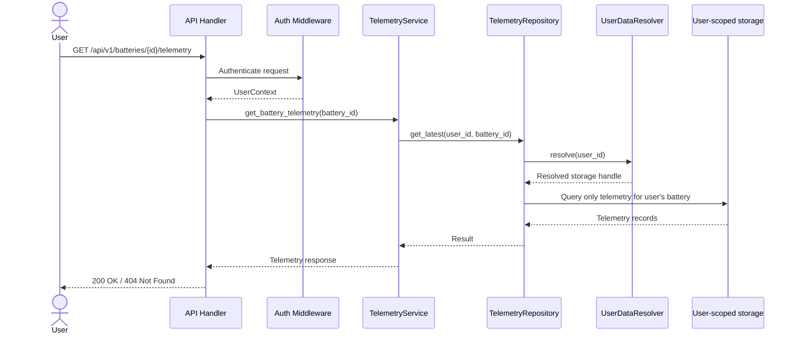

# User-Based BMS Server Architecture

**Status:** Proposed design — documentation only; not implemented.  
**Scope:** Incrementally evolve the current BMS backend toward authenticated multi-user data isolation, with at most one battery fleet per user.

## 1. Goals and constraints

1. A user may own **zero or one** battery fleet.
2. A fleet may contain zero or more batteries.
3. Telemetry belongs to a battery and is visible only through its owning user's context.
4. Every request is scoped using the authenticated identity established by the server.
5. Services depend on repository abstractions, not database or HTTP implementation details.
6. Keep the first implementation small. Add roles, sharing, household hierarchies, queues, caching and distributed services only when required.
7. Preserve the existing BMS device-ingestion and safety behavior while introducing user isolation.

### Important current-state note

The current native C backend is not yet this multi-user design. Its documented configuration supports one dashboard account supplied through environment variables, has no persistent multi-user database, and currently uses a separate device bearer token for telemetry ingestion. This document describes a **future architecture**, not existing functionality. Do not infer that user tables, fleet CRUD, or these services already exist.

## 2. Overall architecture

The API layer authenticates a request and obtains a trusted user context. Application services execute user-scoped use cases. Repository implementations resolve the user's storage internally.



**Dependency direction:** API handlers call application services. Application services use repository contracts. Database-specific code implements those contracts. Domain and application logic must not depend on HTTP framework types or SQL details.

## 3. UML class diagram

The diagram uses UML-style classes to express responsibilities and contracts. In the native C implementation these become modules, opaque structs, and function APIs (or function tables where runtime substitution is useful), not C++ classes.



### Responsibilities

| Component | Responsibility |
|---|---|
| `UserContext` | Carries the authenticated user identity for one request. |
| `FleetService` | Enforces one-fleet-per-user behavior and handles fleet lifecycle. |
| `BatteryService` | Manages batteries belonging to the user's fleet. |
| `TelemetryService` | Reads latest and historical measurements and alert inputs. |
| `FleetAnalyticsService` | Calculates derived fleet metrics; does not own persistence. |
| `FleetRepository` | Persists and retrieves the user's fleet. |
| `BatteryRepository` | Persists and retrieves batteries in the user's scope. |
| `TelemetryRepository` | Retrieves telemetry in the user's scope. |
| `UserDataResolver` | Resolves storage from a trusted user ID; never accepts a client-supplied table name. |

### Service method contracts

**FleetService**
- `create_fleet(data)`
- `get_fleet()`
- `update_fleet(data)`
- `delete_fleet()`
- `fleet_exists()`
- `get_fleet_summary()`

**BatteryService**
- `add_battery(data)`
- `get_batteries()`
- `get_battery(battery_id)`
- `update_battery(battery_id, data)`
- `remove_battery(battery_id)`
- `get_battery_count()`

**TelemetryService**
- `get_latest_telemetry(battery_id)`
- `get_battery_telemetry(battery_id)`
- `get_telemetry_history(battery_id, range)`
- `get_fleet_telemetry()`
- `get_active_alerts()`

**FleetAnalyticsService**
- `get_fleet_health()`
- `calculate_total_capacity()`
- `calculate_average_soc()`
- `calculate_average_soh()`
- `calculate_total_power()`
- `get_fleet_statistics()`

Methods that calculate electrical or battery metrics must define units, aggregation rules, missing/stale sample behavior, and chemistry/configuration assumptions before implementation. Derived values must not be treated as safety interlocks unless independently validated and designed for that purpose.

## 4. Entity relationship diagram

This is the logical data model. The physical storage strategy is intentionally not finalized here.



The `USERS` to `BATTERY_FLEET` relationship is one-to-zero-or-one. Enforce it transactionally and with a unique owner constraint (or equivalent invariant in the chosen storage model).

## 5. Request sequence: retrieve the user's fleet



## 6. Request sequence: retrieve battery telemetry



A battery ID is an identifier, not authorization. The repository must prove that the battery belongs to the authenticated user's fleet before returning its telemetry. Cross-user identifiers should not disclose whether another user's record exists.

## 7. Package and source layout

The existing backend is **native C**, so use C headers and source files rather than Rust module files. This is a proposed target layout; it should be reconciled with the current source tree before code is moved or renamed.

```text
backend-c/
├── include/
│   ├── auth.h
│   ├── user_context.h
│   ├── fleet/
│   │   ├── fleet.h
│   │   └── fleet_repository.h
│   ├── battery/
│   │   ├── battery.h
│   │   └── battery_repository.h
│   ├── telemetry/
│   │   ├── telemetry.h
│   │   └── telemetry_repository.h
│   └── storage/
│       └── user_data_resolver.h
├── src/
│   ├── auth/
│   ├── api/
│   ├── fleet/
│   │   └── fleet_service.c
│   ├── battery/
│   │   └── battery_service.c
│   ├── telemetry/
│   │   └── telemetry_service.c
│   ├── analytics/
│   │   └── fleet_analytics_service.c
│   └── storage/
│       ├── user_data_resolver.c
│       └── repositories/
├── tests/
│   ├── unit/
│   ├── integration/
│   └── security/
└── CMakeLists.txt
```

Do not create empty modules merely to match this tree. Introduce each module when its behavior is ready to be implemented and tested. Existing BMS safety/domain modules remain independent of HTTP and user persistence.

## 8. SOLID mapping

| Principle | Application |
|---|---|
| Single Responsibility | Fleet, battery, telemetry and analytics logic have separate responsibilities. |
| Open/Closed | Add another repository implementation or analytics calculation without rewriting domain behavior. |
| Liskov Substitution | Every repository implementation honors the same contract, errors and ownership guarantees. |
| Interface Segregation | Fleet, battery and telemetry persistence contracts remain separate. |
| Dependency Inversion | Application services depend on repository contracts rather than a concrete database driver. |

In C, keep interfaces proportionate. A small header defining function contracts is sufficient initially. Use function-pointer tables only where runtime substitution is actually needed, such as production versus test repositories.

## 9. Storage strategy: decision still open

The original proposal was to give each user a separate table containing their entities. That is one possible physical implementation, but it is not yet a finalized database decision.

Possible approaches:

- **One physical table per user:** strong physical separation, but increases schema/catalog size, migration work, dynamic SQL complexity and operational overhead as users grow.
- **Shared tables with `user_id`:** simpler migrations and indexing; isolation must be enforced on every query, ideally also through database constraints or row-level security where supported.
- **Separate schema/database per user:** stronger namespace or database isolation, with greater provisioning and operational cost.

Whichever option is selected:
- derive storage identifiers on the server from authenticated identity;
- never interpolate an untrusted table name into SQL;
- use parameterized values and strict identifier validation/quoting;
- apply ownership checks in the persistence layer;
- use transactions for fleet creation and deletion;
- test concurrent attempts to create a second fleet.

The logical entity model is also open: generic entity records with a type discriminator and JSON payload versus typed fleet, battery and telemetry tables. Do not treat either as finalized by this document.

## 10. Incremental implementation plan

1. **Identity foundation:** persistent users, registration/login, secure sessions and a trusted request-scoped user context.
2. **Storage foundation:** choose the storage strategy, add migrations and implement the user data resolver/repository boundary.
3. **Fleet lifecycle:** create/read/update/delete the single fleet, with a database-enforced one-fleet-per-user invariant.
4. **Battery lifecycle:** manage batteries only within the user's fleet.
5. **Telemetry:** associate device ingestion with a user-owned battery; retain a distinct device-authentication mechanism.
6. **Analytics:** add derived fleet metrics with explicit units, validity and staleness rules.

Each step requires unit, integration and cross-user isolation tests before moving to the next. Do not enable hardware control or alter existing safety interlocks as part of the multi-user data-model work.

## 11. Security and correctness invariants

- User identity comes from verified server-side authentication, never from a request body or query parameter.
- Every fleet, battery and telemetry repository operation is user-scoped.
- A user can own no more than one fleet.
- A battery belongs to exactly one fleet.
- Telemetry belongs to a battery and is reachable only through its owner's scope.
- Fleet deletion and dependent-record handling are transactional and explicitly defined.
- Missing or stale telemetry is represented explicitly; it is not silently treated as zero.
- Device ingestion credentials remain distinct from dashboard user sessions.
- Multi-user support must not weaken the existing hardware safety worker, interlocks, commissioning gate or local controller protections.

## 12. Out of scope for this first version

Roles and permissions, household membership, fleet sharing, multiple fleets per user, microservices, event buses, distributed caching, background analytics workers and multi-region deployment.

These can be considered later when a concrete requirement justifies them.
